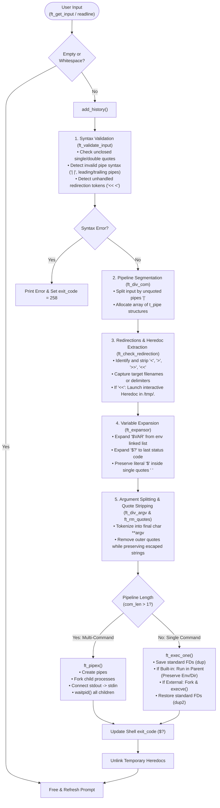

# minishell 🐚 — POSIX Command Line Interpreter in C

<div align="center">

[](https://en.wikipedia.org/wiki/C_(programming_language))
[-green?style=for-the-badge)](https://pubs.opengroup.org/onlinepubs/9699919799/)
[](https://www.42madrid.com/)
[](https://valgrind.org/)
[](LICENSE)

**A fully functional, robust Unix command line interpreter engineered from scratch in C, faithfully recreating the core architecture, process management, and syntax semantics of GNU Bash.**

[Overview](#-overview) • [Pipeline & Parsing Architecture](#-pipeline--parsing-architecture) • [Execution Engine](#-execution-engine--process-orchestration) • [Built-in Commands](#-built-in-commands) • [Redirections & Heredocs](#-redirections--heredoc-management) • [Signal Handling](#-signal-handling) • [Quickstart](#-installation--compilation)

</div>

---

## 📖 Overview

**minishell** is a custom Unix shell implementation developed as part of the rigorous **42 Curriculum**. It bridges the gap between low-level kernel system calls and high-level user interaction, implementing a full **Read-Eval-Print Loop (REPL)**.

The project handles complex POSIX command parsing, dynamic multi-level pipes, input/output redirections, here-documents with runtime variable expansion, environment variable state management, and real-time POSIX signal handling.

---

## 🏗️ Pipeline & Parsing Architecture

Input processing follows a multi-phase compiler-style pipeline that sanitizes, tokenizes, expands, and isolates commands before execution.



---

## ⚙️ Execution Engine & Process Orchestration

Minishell features two specialized execution branches to guarantee POSIX compliance and preserve shell state:

### 1. Single Command Execution (`ft_exec_one`)

When executing an isolated command:
- **Parent State Preservation:** Built-ins that alter shell state (`cd`, `export`, `unset`, `exit`) **must run inside the parent process**. Running them in a child fork would discard directory changes and environment mutations upon termination.
- **FD Swapping with Rollback:**
  ```c
  // Preserving original STDIN / STDOUT before redirection
  int saved_stdin = dup(STDIN_FILENO);
  int saved_stdout = dup(STDOUT_FILENO);

  // Apply file redirections
  dup2(file_fd, STDOUT_FILENO);
  execute_command();

  // Instant restoration
  dup2(saved_stdin, STDIN_FILENO);
  dup2(saved_stdout, STDOUT_FILENO);
  ```

---

### 2. Multi-Process Pipeline Orchestration (`ft_pipex`)

When chaining commands with pipes (`cmd1 | cmd2 | ... | cmdN`):
1. An array of UNIX pipes (`int fd[2]`) is instantiated.
2. For each intermediate process, standard output is redirected into the pipe write-end:
   $$\text{STDOUT} \longrightarrow \text{pipe}[1]$$
3. The subsequent process redirects standard input from the previous pipe read-end:
   $$\text{STDIN} \longleftarrow \text{pipe}[0]$$
4. The parent process ignores `SIGINT`, waits for all spawned PIDs via `waitpid(-1, &wstatus, 0)`, and extracts the exact exit status of the final command using the `WEXITSTATUS` macro.

---

## 🛠️ Built-in Commands

All built-in utilities are natively implemented without relying on `/bin` executables:

| Built-in | Flags Supported | Description |
| :--- | :---: | :--- |
| `echo` | `-n` *(multiple permitted: `-n -n -nnn`)* | Prints text to STDOUT, suppressing trailing newline if flag is present. |
| `cd` | Relative / Absolute paths | Changes working directory via `chdir()` and synchronizes `PWD` & `OLDPWD`. |
| `pwd` | None | Displays current absolute working path via `getcwd()`. |
| `export` | `KEY=VALUE` / `KEY` | Registers or updates environment variables in the internal linked list. Prints sorted env list if called without arguments. |
| `unset` | Variable names | Deletes specified variables from the environment table. |
| `env` | None | Prints all exported environment key-value pairs. |
| `exit` | `[exit_code]` | Exits the shell, validating numeric arguments and performing modulo-256 arithmetic. |

---

## 📥 Redirections & Heredoc Management

Minishell supports full POSIX file descriptor redirections:

```ini
# Input Redirection
cat < input.txt

# Output Truncation (O_CREAT | O_WRONLY | O_TRUNC, perm 0644)
ls -la > output.txt

# Output Append (O_CREAT | O_WRONLY | O_APPEND, perm 0644)
echo "New log entry" >> server.log

# Here-Document (Interactive multi-line input)
cat << EOF > notes.txt
```

### Heredoc Architecture (`ft_here_doc.c`)
- Heredocs generate uniquely named hidden temporary files located at `/tmp/.<random_hash>`.
- Lines are captured in real-time via `readline("> ")` until the strict delimiter is encountered.
- Unless the delimiter is quoted (e.g. `'EOF'`), variable expansions (`$USER`, `$?`) are resolved dynamically before writing to disk.
- All temporary files are guaranteed to be unlinked (`unlink()`) immediately after pipeline execution completes.

---

## ⚡ Signal Handling

Signal handling dynamically adapts depending on whether the shell is awaiting user input or supervising active child processes:

| Context | `SIGINT` (<kbd>Ctrl</kbd> + <kbd>C</kbd>) | `SIGQUIT` (<kbd>Ctrl</kbd> + <kbd>\</kbd>) | `EOF` (<kbd>Ctrl</kbd> + <kbd>D</kbd>) |
| :--- | :--- | :--- | :--- |
| **Interactive Prompt** | Clears buffer, displays a newline, and redraws prompt | Ignored (`SIG_IGN`) | Exits shell cleanly with current `exit_code` |
| **Child Execution** | Interrupts foreground process (Exit code 130) | Core dumps / quits foreground process (Exit code 131) | Handled by child program's stdin |
| **Here-Doc Prompt** | Cancels here-doc, closes temporary fd, returns to prompt | Ignored (`SIG_IGN`) | Finalizes heredoc with warning |

---

## 🧪 Verification & Complex Examples

Test the shell against these complex Bash scenarios:

```bash
# Multi-stage pipe with subshell lookalikes
cat /etc/passwd | grep -v nobody | awk -F: '{print $1}' | sort | head -n 5

# Heredoc piped into sorting and redirected to file
cat << DELIM | grep 42 | wc -l > result.txt
hello 42
this is a test
42 Madrid
DELIM

# Quote preservation & variable expansion
export GREETING="Hello World"
echo "$GREETING from '$USER'"
echo '$GREETING will not expand here'

# Exit status verification
ls non_existent_file
echo $? # Outputs 2 (or 1 depending on OS)
```

---

## 🚀 Installation & Compilation

### Prerequisites

Ensure you have `gcc` / `clang`, `make`, and the GNU Readline development library installed:

```bash
# Ubuntu / Debian
sudo apt-get update
sudo apt-get install -y build-essential libreadline-dev

# macOS (Homebrew)
brew install readline
```

### Compilation

```bash
# 1. Clone repository
git clone https://github.com/albartol/minishell_42.git
cd minishell_42

# 2. Compile binary
make

# 3. Launch minishell
./minishell
```

<details>
<summary><b>🛠️ Available Make Targets</b></summary>

- `make` — Compiles `libft` and generates the `./minishell` executable.
- `make clean` — Deletes compiled object files (`.o`).
- `make fclean` — Deletes object files and the `./minishell` binary.
- `make re` — Performs a complete re-compilation.
</details>

---

## 👥 Authors

Engineered with ❤️ at **42 Madrid**:

- **Fabricio López Reyes** ([@SherlockPE](https://github.com/SherlockPE))
- **Alejandro Bartolomé Blanco** ([@Albartol](https://github.com/albartol))

